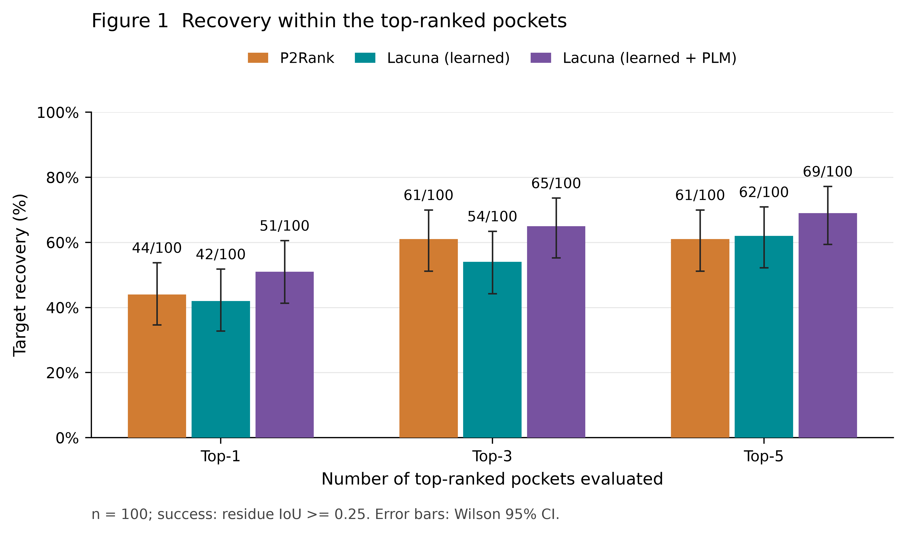
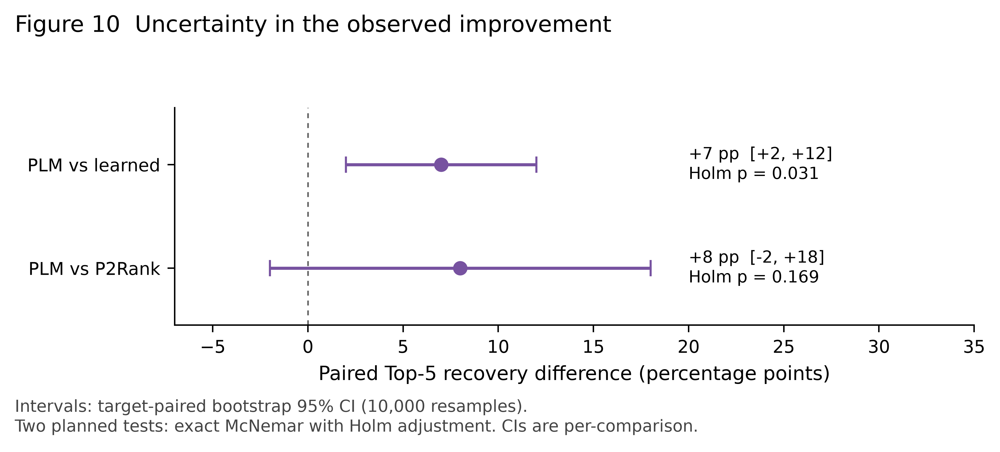

# Cryptic Pocket Benchmark

A reproducible comparison of **P2Rank**, **Lacuna learned**, and **Lacuna learned + PLM** on a frozen, filtered cohort of 100 CryptoBench targets.

This repository contributes the comparison workflow, input preparation, evaluation, and visualizations. The pocket predictors and protein language model are developed by their respective upstream authors. No model was trained on these 100 targets for this project.

## Main result

| Configuration | Top-1 | Top-3 | Top-5 |
|---|---:|---:|---:|
| P2Rank 2.5.1 default | 44/100 | 61/100 | 61/100 |
| Lacuna 1.2.0 learned | 42/100 | 54/100 | 62/100 |
| Lacuna 1.2.0 learned + PLM | **51/100** | **65/100** | **69/100** |

A target is recovered when at least one of the top-k individual pockets has residue IoU >= 0.25 with the reference annotation. This is target recovery, not binding probability, docking accuracy, or therapeutic efficacy.

The PLM configuration improves Top-5 recovery over learned by **7 percentage points** (paired bootstrap 95% CI +2 to +12; Holm-adjusted exact McNemar p = 0.03125). Its observed advantage over P2Rank is **8 points**, but that comparison remains uncertain (95% CI -2 to +18; adjusted p = 0.16864). These conclusions apply to this selected cohort and evaluation protocol.



## Start here

There are two ways to use this project:

1. **Inspect and verify the existing comparison.** No GPU, Java, P2Rank, or Lacuna installation is needed for the offline summary check.
2. **Run the predictors again.** Install the optional dependencies and provide the pinned P2Rank and ESM-2 installations.

### Inspect the results

Use Python 3.11 or newer from the repository root:

```bash
python -m pip install -e .
pocketbench verify
```

This checks all input hashes and mappings, the stored prediction structure, Top-k totals, and paired statistics. It does **not** independently rescore the reference overlap.

To independently rescore all 300 published prediction sets:

```bash
pocketbench prepare
pocketbench evaluate --published
```

`prepare` explicitly downloads the pinned external CryptoBench annotations, verifies their SHA-256, and maps them to the bundled input numbering. The downloaded annotations and generated reference file are excluded from Git.

Open [`docs/index.html`](docs/index.html) locally for an English results viewer, or read the [methods](docs/methods.md). Browse the [100-target list](data/cohort.csv) and [machine-readable results](data/published/summary.json).

### Run a small example

The original calculations used WSL Ubuntu, Python 3.11, Java 25, and an NVIDIA RTX 5070. Linux/WSL is the documented inference environment. CUDA is required for the original PLM numerical path.

```bash
python -m pip install -e '.[run,plm]'
# Original GPU stack; install the appropriate NVIDIA driver separately.
python -m pip install torch==2.7.1 --index-url https://download.pytorch.org/whl/cu128
pocketbench install-p2rank
pocketbench download-model

pocketbench run --target B003 \
  --p2rank tools/p2rank_2.5.1/prank \
  --model-dir models/esm2_t33_650M_UR50D \
  --out runs/example-B003

pocketbench evaluate --run-dir runs/example-B003
```

The ESM-2 encoder download is approximately 2.6 GB. If these tools are already installed, pass their existing paths instead. Model and source hashes are checked before inference. A PLM failure is recorded as a failure; it is never silently replaced by the learned ranker.

To run all 100 targets, omit `--target` and choose a new output directory. To run only the two CPU configurations, add `--models p2rank,learned`; those outputs form a two-configuration comparison. See [reproduction instructions](docs/reproduction.md) for installation, resume behavior, numerical differences, and failure accounting.

## What is being compared?

- **P2Rank** predicts pockets from the supplied single structure using its default pretrained model.
- **Lacuna learned** ranks geometry-derived candidates pooled over the input structure and 20 NMA conformers.
- **Lacuna learned + PLM** reranks the **same complete Lacuna candidate pool**, adding four sequence-derived features from the ESM-2 residue head.

The two Lacuna rankers share all proposed pockets. The observed learned-to-PLM gain therefore reflects changed ranking within this candidate pool. Their geometric coefficients also differ, so this is not an ablation of a single added feature.



## Read the limitations before reusing the headline

- The 100 targets come from the authors' designated CryptoBench **test fold**, with filtering for structure quality, duplicate identity, and detectable close homology to documented supervised/development sets. This is **not a development-blind external validation**.
- The Lacuna authors observed test-fold performance during development. Absence of these sequences from **ESM-2 pretraining is not established**.
- Categories are unequal: kinase 2, protease 5, other enzyme 61, nucleotide binding/switch 3, and nonenzymatic binding/regulation/transport 29. The kinase group contains a histidine kinase and an MLKL pseudokinase. Category-level conclusions are descriptive.
- References are the CryptoBench authors' annotated cryptic-residue **union**, which can contain multiple sites. We use residue IoU only. The upstream benchmark's main-pocket and distance criteria differ, so the published headline is not being reproduced exactly.
- NMA produces structural samples. The 21 structures are **not a time-resolved MD trajectory** and do not establish opening rates, equilibrium probabilities, or free energies.
- The comparison uses **default P2Rank**, not a company-tuned Pharmaco-net implementation. No internal company code or proprietary target data is included.

See [selection and leakage scope](docs/selection.md) and [limitations](docs/limitations.md).

## Regenerate the English figures

```bash
python -m pip install -e '.[plots]'
python scripts/make_figures.py
```

Figures 1, 2, 3, 9, 10 and 12 are supplied as 600 dpi PNG and editable-text SVG. Captions describe the uncertainty definitions. Figure 3 uses a blue-white-red piecewise scale centered on the prespecified IoU threshold 0.25. The scripts operate on the frozen published results and do not rerun predictions.

## Repository layout

```text
config/          Frozen protocol, external reference source, original provenance
data/inputs/     100 prepared PDB chains with reversible residue mappings
data/published/  Predictions, target metrics, statistical summaries
docs/            English methods, limitations, viewer, and figures
scripts/         Figure regeneration
src/pocketbench/ Portable CLI, inference adapters, and evaluation code
tests/           Evaluation edge cases
```

The repository contains the frozen cohort rather than an automatic selector for arbitrary new datasets. It does not bundle upstream model weights, raw external reference annotations, the earlier local web application, or internal project reports.

## Credits and reuse

- [Lacuna](https://github.com/mooreneural/lacuna), Clayton Moore: ensemble pocket discovery and both pretrained rankers.
- [P2Rank](https://github.com/rdk/p2rank): the default structure-based predictor.
- [CryptoBench](https://doi.org/10.1093/bioinformatics/btae745): benchmark structures and reference annotations.
- [ESM-2](https://huggingface.co/facebook/esm2_t33_650M_UR50D): pretrained protein sequence encoder.
- [RCSB PDB / wwPDB](https://www.rcsb.org): experimental structure data and original structure depositors.

Our code and original documentation are MIT-licensed. Upstream software, models, structures, and annotations retain their own terms. See [NOTICE](NOTICE.md) and [references](docs/references.md). Cite the upstream research when using those tools or data, and cite this repository when using this comparison workflow.
